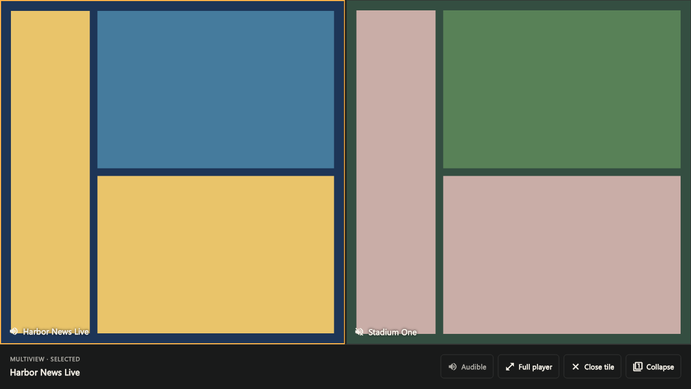

<div align="center">


# Wabbit TV

**A calm, fast IPTV player for Windows that brings your own sources together in one library.**

[](https://github.com/tcurtsinger/WabbitTV/actions/workflows/ci.yml)
[](LICENSE)


</div>

Wabbit TV turns large Xtream and M3U catalogs into one quiet, keyboard-first library. Live TV, movies and series from all your sources sit side by side, search is instant, and everything stays on your PC.

> [!NOTE]
> Wabbit TV supplies **no content**: no channels, playlists, movies or series. Use it only with sources you are entitled to access.

<table>
  <tr>
    <td></td>
    <td></td>
  </tr>
  <tr>
    <td></td>
    <td></td>
  </tr>
</table>
<p align="center"><sub>Screenshots use the built-in synthetic sample catalog.</sub></p>

## Features

**Sources**
- Xtream Codes accounts, M3U playlist URLs, and local M3U files
- As many sources as you like, each refreshable, renamable and switchable on or off
- Background import that copes with catalogs of 250,000+ items

**Library**
- One unified Live / Movies / Series library across every source, or narrow it to a single source
- Search as you type, backed by a local full-text index
- Favorites and your own custom groups (mixing live, movies and series), pinned to Home in the order you choose
- Hide whole categories or single items you never want to see

**Watching**
- Full-screen player with audio and subtitle tracks, resume, and watch history
- Corner picture-in-picture while you keep browsing, and two-channel side-by-side multiview
- Automatic recovery from network drops, and a fallback to the same channel on another source
- Respects your provider's connection limit
- TV guide with now/next for Xtream live channels
- Start up on Home, any section, or straight into your last channel

**Built for the couch and the desk**
- Every screen works with arrow keys and Enter, with a clear amber focus ring
- On-screen TV keyboard for remote-style text entry

## Privacy and security

- **Local-first.** Your catalog, favorites, groups and history live in a SQLite database on your PC. No accounts, no telemetry, no Wabbit servers.
- **Network use.** Wabbit TV only connects to the sources you add, and to the stream, artwork and guide addresses those sources hand it.
- **Logins.** Xtream passwords are encrypted with your Windows account (DPAPI) and never stored in the catalog database.
- **Secure streams.** HTTPS streams are verified against a bundled Mozilla root certificate list.

## Getting started

There are no prebuilt releases yet, so you build it from source.

### Requirements

- Windows 10 or 11 (64-bit)
- [Flutter](https://docs.flutter.dev/get-started/install/windows/desktop) 3.47 (stable)
- Visual Studio 2022 (Build Tools are enough) with the **Desktop development with C++** workload and the **C++ ATL** component

### Build and run

```powershell
git clone https://github.com/tcurtsinger/WabbitTV.git
cd WabbitTV
flutter pub get
flutter run -d windows
```

For an optimized build:

```powershell
flutter build windows --release
```

The app ends up at `build\windows\x64\runner\Release\wabbit_tv.exe`. Open it, choose **Add source**, and enter your Xtream account or M3U playlist.

> [!TIP]
> If the build hangs while CMake detects the compiler, run `$env:TrackFileAccess = 'false'` in that PowerShell window and build again.

## Keyboard shortcuts

| Where | Keys | Action |
|---|---|---|
| Everywhere | Arrow keys, Enter | Move focus, select |
| Everywhere | Esc | Back / open the navigation rail |
| Player | Space, K, media Play/Pause | Play / pause |
| Player | ← / → | Seek back / forward 10 s (movies and episodes; hold to keep seeking) |
| Player | F, or double-click the video | Fullscreen on / off |
| Player | M | Mute on / off |

## Development

```powershell
dart format lib test   # formatting
flutter analyze        # static analysis
flutter test           # 600+ unit and widget tests
```

GitHub Actions runs all of these, plus a release build, on every pull request.

<details>
<summary><b>Synthetic preview fixtures and probes</b></summary>

These run the real UI against built-in synthetic data. They never touch a real provider.

| Command | Shows |
|---|---|
| `flutter run -d windows --dart-define=WABBIT_HOME_FIXTURE=populated` | Home with shelves (also `no-sources`, `no-personalization`) |
| `flutter run -d windows --dart-define=WABBIT_BROWSE_FIXTURE=live` | Browse with a sample catalog (also `movies`, `series`) |
| `flutter run -d windows -t lib/src/spikes/phase1/production_player_fixture_main.dart` | The player with an in-memory transport |
| `flutter run -d windows --dart-define=WABBIT_SQLITE_PROBE=true` | SQLite + FTS5 self-check, printed to stdout |
| `flutter run -d windows --dart-define=WABBIT_CATALOG_SCALE_PROBE=true` | 50k-item import and search timings |

</details>

### Project layout

```text
lib/
├── main.dart
└── src/
    ├── app_shell.dart        # navigation rail, routing, playback surfaces
    └── features/
        ├── sources/          # Xtream + M3U import, SQLite catalog, credentials
        ├── browse/           # Live / Movies / Series lists
        ├── search/           # full-text search
        ├── library/          # favorites and custom groups
        ├── guide/            # TV guide
        ├── playback/         # player, picture-in-picture, multiview (media_kit)
        ├── home/             # Home shelves
        ├── artwork/          # artwork loading and cache
        └── settings/         # general settings
```

## Roadmap

- **Android TV, Google TV and Fire TV.** The interface is already remote-first. Next comes the Android build.
- Prebuilt Windows releases

## Built with

[Flutter](https://flutter.dev) · [media_kit](https://github.com/media-kit/media-kit) (libmpv) · [SQLite](https://sqlite.org) with FTS5 via [sqlite3](https://pub.dev/packages/sqlite3) · [flutter_secure_storage](https://pub.dev/packages/flutter_secure_storage)

## License

[GNU Affero General Public License v3.0](LICENSE)
